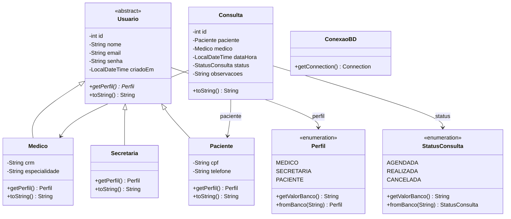

# Projeto: Persistência do Sistema de Atendimento Médico (1ª Entrega)

Este guia contém todos os arquivos necessários para montar o projeto `poo-atendimento` conforme a estrutura exigida pela especificação da disciplina de Programação Orientada a Objetos (2026.2), além do documento oficial preenchido para envio no Canvas.

---

## 1. Estrutura de Pastas do Projeto

Crie uma pasta chamada `poo-atendimento` e organize os arquivos exatamente conforme abaixo:

```text
poo-atendimento/
├── .gitignore
├── pom.xml
├── banco/
│   ├── schema.sql
│   └── dados.sql
├── docs/
│   └── diagrama-classes.mmd  (Código Mermaid para exportar como diagrama-classes.png)
└── src/
    └── main/
        ├── java/
        │   └── br/
        │       └── edu/
        │           └── unifacisa/
        │               └── atendimento/
        │                   ├── Main.java
        │                   ├── db/
        │                   │   └── ConexaoBD.java
        │                   └── model/
        │                       ├── Consulta.java
        │                       ├── Medico.java
        │                       ├── Paciente.java
        │                       ├── Perfil.java
        │                       ├── Secretaria.java
        │                       ├── StatusConsulta.java
        │                       └── Usuario.java
        └── resources/
            └── db.properties.example
```

---

## 2. Arquivos de Configuração e Banco de Dados

### `.gitignore`
```gitignore
target/
.idea/
*.iml
.vscode/
.settings/
.classpath
.project
src/main/resources/db.properties
```

### `pom.xml`
```xml
<?xml version="1.0" encoding="UTF-8"?>
<project xmlns="http://maven.apache.org/POM/4.0.0"
         xmlns:xsi="http://www.w3.org/2001/XMLSchema-instance"
         xsi:schemaLocation="http://maven.apache.org/POM/4.0.0 http://maven.apache.org/xsd/maven-4.0.0.xsd">
    <modelVersion>4.0.0</modelVersion>

    <groupId>br.edu.unifacisa</groupId>
    <artifactId>poo-atendimento</artifactId>
    <version>1.0-SNAPSHOT</version>

    <properties>
        <maven.compiler.source>17</maven.compiler.source>
        <maven.compiler.target>17</maven.compiler.target>
        <project.build.sourceEncoding>UTF-8</project.build.sourceEncoding>
    </properties>

    <dependencies>
        <dependency>
            <groupId>com.mysql</groupId>
            <artifactId>mysql-connector-j</artifactId>
            <version>8.3.0</version>
        </dependency>
    </dependencies>
</project>
```

### `src/main/resources/db.properties.example`
*(Copie este arquivo para `src/main/resources/db.properties` na sua máquina e preencha com sua senha real do MySQL).*
```properties
db.url=jdbc:mysql://localhost:3306/atendimento_medico
db.usuario=root
db.senha=sua-senha
```

### `banco/schema.sql`
```sql
CREATE DATABASE IF NOT EXISTS atendimento_medico
CHARACTER SET utf8mb4 COLLATE utf8mb4_0900_ai_ci;

USE atendimento_medico;

CREATE TABLE usuarios (
    id INT AUTO_INCREMENT PRIMARY KEY,
    nome VARCHAR(120) NOT NULL,
    email VARCHAR(160) NOT NULL UNIQUE,
    senha VARCHAR(255) NOT NULL,
    perfil ENUM('medico', 'secretaria', 'paciente') NOT NULL,
    crm VARCHAR(20) NULL,
    especialidade VARCHAR(80) NULL,
    cpf CHAR(11) NULL UNIQUE,
    telefone VARCHAR(20) NULL,
    criado_em DATETIME NOT NULL DEFAULT CURRENT_TIMESTAMP,
    atualizado_em DATETIME NOT NULL DEFAULT CURRENT_TIMESTAMP ON UPDATE CURRENT_TIMESTAMP
);

CREATE TABLE consultas (
    id INT AUTO_INCREMENT PRIMARY KEY,
    paciente_id INT NOT NULL,
    medico_id INT NOT NULL,
    data_hora DATETIME NOT NULL,
    status ENUM('agendada', 'realizada', 'cancelada') NOT NULL DEFAULT 'agendada',
    observacoes TEXT NULL,
    criado_em DATETIME NOT NULL DEFAULT CURRENT_TIMESTAMP,
    atualizado_em DATETIME NOT NULL DEFAULT CURRENT_TIMESTAMP ON UPDATE CURRENT_TIMESTAMP,
    FOREIGN KEY (paciente_id) REFERENCES usuarios(id),
    FOREIGN KEY (medico_id) REFERENCES usuarios(id),
    UNIQUE (medico_id, data_hora)
);
```

### `banco/dados.sql`
```sql
USE atendimento_medico;

-- 1 Secretária
INSERT INTO usuarios (nome, email, senha, perfil) VALUES
('Mariana Costa', 'mariana.secretaria@clinica.com', 'senha123', 'secretaria');

-- 2 Médicos
INSERT INTO usuarios (nome, email, senha, perfil, crm, especialidade) VALUES
('Dr. Carlos Mendes', 'carlos.mendes@clinica.com', 'medico123', 'medico', 'CRM-PB 1234', 'Cardiologia'),
('Dra. Fernanda Lima', 'fernanda.lima@clinica.com', 'medico456', 'medico', 'CRM-PB 5678', 'Dermatologia');

-- 3 Pacientes
INSERT INTO usuarios (nome, email, senha, perfil, cpf, telefone) VALUES
('João Silva', 'joao.silva@email.com', 'pac123', 'paciente', '11122233344', '(83) 99999-1111'),
('Ana Paula Souza', 'ana.souza@email.com', 'pac456', 'paciente', '22233344455', '(83) 99999-2222'),
('Pedro Henrique Alves', 'pedro.alves@email.com', 'pac789', 'paciente', '33344455566', '(83) 99999-3333');

-- 4 Consultas (IDs: Secretária=1, Médicos=2 e 3, Pacientes=4, 5 e 6)
INSERT INTO consultas (paciente_id, medico_id, data_hora, status, observacoes) VALUES
(4, 2, '2026-11-20 09:00:00', 'agendada', 'Consulta de rotina cardiológica.'),
(5, 3, '2026-11-20 10:30:00', 'agendada', 'Avaliação dermatológica inicial.'),
(6, 2, '2026-11-10 14:00:00', 'realizada', 'Paciente apresentou pressão arterial estável. Exames solicitados.'),
(4, 3, '2026-11-12 16:00:00', 'cancelada', 'Cancelada a pedido do paciente.');
```

---

## 3. Código-Fonte Java (`src/main/java/br/edu/unifacisa/atendimento/`)

### `model/Perfil.java`
```java
package br.edu.unifacisa.atendimento.model;

public enum Perfil {
    MEDICO("medico"),
    SECRETARIA("secretaria"),
    PACIENTE("paciente");

    private final String valorBanco;

    Perfil(String valorBanco) {
        this.valorBanco = valorBanco;
    }

    public String getValorBanco() {
        return valorBanco;
    }

    public static Perfil fromBanco(String texto) {
        if (texto == null) {
            throw new IllegalArgumentException("Perfil não pode ser nulo.");
        }
        for (Perfil p : values()) {
            if (p.valorBanco.equalsIgnoreCase(texto.trim())) {
                return p;
            }
        }
        throw new IllegalArgumentException("Perfil inválido: " + texto);
    }
}
```

### `model/StatusConsulta.java`
```java
package br.edu.unifacisa.atendimento.model;

public enum StatusConsulta {
    AGENDADA("agendada"),
    REALIZADA("realizada"),
    CANCELADA("cancelada");

    private final String valorBanco;

    StatusConsulta(String valorBanco) {
        this.valorBanco = valorBanco;
    }

    public String getValorBanco() {
        return valorBanco;
    }

    public static StatusConsulta fromBanco(String texto) {
        if (texto == null) {
            throw new IllegalArgumentException("Status da consulta não pode ser nulo.");
        }
        for (StatusConsulta s : values()) {
            if (s.valorBanco.equalsIgnoreCase(texto.trim())) {
                return s;
            }
        }
        throw new IllegalArgumentException("Status de consulta inválido: " + texto);
    }
}
```

### `model/Usuario.java`
```java
package br.edu.unifacisa.atendimento.model;

import java.time.LocalDateTime;

public abstract class Usuario {
    private int id;
    private String nome;
    private String email;
    private String senha;
    private LocalDateTime criadoEm;

    public Usuario() {
        this.criadoEm = LocalDateTime.now();
    }

    public Usuario(int id, String nome, String email, String senha, LocalDateTime criadoEm) {
        this.id = id;
        setNome(nome);
        setEmail(email);
        setSenha(senha);
        this.criadoEm = criadoEm != null ? criadoEm : LocalDateTime.now();
    }

    public abstract Perfil getPerfil();

    public int getId() {
        return id;
    }

    public void setId(int id) {
        this.id = id;
    }

    public String getNome() {
        return nome;
    }

    public void setNome(String nome) {
        if (nome == null || nome.trim().isEmpty()) {
            throw new IllegalArgumentException("O nome do usuário é obrigatório.");
        }
        this.nome = nome.trim();
    }

    public String getEmail() {
        return email;
    }

    public void setEmail(String email) {
        if (email == null || !email.trim().matches("^[\\w.-]+@[\\w.-]+\\.[a-zA-Z]{2,}$")) {
            throw new IllegalArgumentException("E-mail obrigatório e deve estar em formato válido.");
        }
        this.email = email.trim().toLowerCase();
    }

    public String getSenha() {
        return senha;
    }

    public void setSenha(String senha) {
        if (senha == null || senha.length() < 6) {
            throw new IllegalArgumentException("A senha deve conter no mínimo 6 caracteres.");
        }
        this.senha = senha;
    }

    public LocalDateTime getCriadoEm() {
        return criadoEm;
    }

    public void setCriadoEm(LocalDateTime criadoEm) {
        this.criadoEm = criadoEm;
    }

    @Override
    public String toString() {
        return String.format("Usuario{id=%d, perfil=%s, nome='%s', email='%s'}",
                id, getPerfil().getValorBanco(), nome, email);
    }
}
```

### `model/Medico.java`
```java
package br.edu.unifacisa.atendimento.model;

import java.time.LocalDateTime;

public class Medico extends Usuario {
    private String crm;
    private String especialidade;

    public Medico() {
        super();
    }

    public Medico(int id, String nome, String email, String senha, LocalDateTime criadoEm,
                  String crm, String especialidade) {
        super(id, nome, email, senha, criadoEm);
        setCrm(crm);
        setEspecialidade(especialidade);
    }

    @Override
    public Perfil getPerfil() {
        return Perfil.MEDICO;
    }

    public String getCrm() {
        return crm;
    }

    public void setCrm(String crm) {
        if (crm == null || crm.trim().isEmpty()) {
            throw new IllegalArgumentException("CRM é obrigatório para médico.");
        }
        this.crm = crm.trim();
    }

    public String getEspecialidade() {
        return especialidade;
    }

    public void setEspecialidade(String especialidade) {
        if (especialidade == null || especialidade.trim().isEmpty()) {
            throw new IllegalArgumentException("Especialidade é obrigatória para médico.");
        }
        this.especialidade = especialidade.trim();
    }

    @Override
    public String toString() {
        return String.format("Medico{id=%d, nome='%s', email='%s', crm='%s', especialidade='%s'}",
                getId(), getNome(), getEmail(), crm, especialidade);
    }
}
```

### `model/Secretaria.java`
```java
package br.edu.unifacisa.atendimento.model;

import java.time.LocalDateTime;

public class Secretaria extends Usuario {

    public Secretaria() {
        super();
    }

    public Secretaria(int id, String nome, String email, String senha, LocalDateTime criadoEm) {
        super(id, nome, email, senha, criadoEm);
    }

    @Override
    public Perfil getPerfil() {
        return Perfil.SECRETARIA;
    }

    @Override
    public String toString() {
        return String.format("Secretaria{id=%d, nome='%s', email='%s'}",
                getId(), getNome(), getEmail());
    }
}
```

### `model/Paciente.java`
```java
package br.edu.unifacisa.atendimento.model;

import java.time.LocalDateTime;

public class Paciente extends Usuario {
    private String cpf;
    private String telefone;

    public Paciente() {
        super();
    }

    public Paciente(int id, String nome, String email, String senha, LocalDateTime criadoEm,
                    String cpf, String telefone) {
        super(id, nome, email, senha, criadoEm);
        setCpf(cpf);
        setTelefone(telefone);
    }

    @Override
    public Perfil getPerfil() {
        return Perfil.PACIENTE;
    }

    public String getCpf() {
        return cpf;
    }

    public void setCpf(String cpf) {
        if (cpf == null || !cpf.replaceAll("\\D", "").matches("\\d{11}")) {
            throw new IllegalArgumentException("CPF inválido. Deve conter exatamente 11 dígitos numéricos.");
        }
        this.cpf = cpf.replaceAll("\\D", "");
    }

    public String getTelefone() {
        return telefone;
    }

    public void setTelefone(String telefone) {
        if (telefone == null || telefone.trim().isEmpty()) {
            throw new IllegalArgumentException("Telefone do paciente é obrigatório.");
        }
        this.telefone = telefone.trim();
    }

    @Override
    public String toString() {
        return String.format("Paciente{id=%d, nome='%s', email='%s', cpf='%s', telefone='%s'}",
                getId(), getNome(), getEmail(), cpf, telefone);
    }
}
```

### `model/Consulta.java`
```java
package br.edu.unifacisa.atendimento.model;

import java.time.LocalDateTime;

public class Consulta {
    private int id;
    private Paciente paciente;
    private Medico medico;
    private LocalDateTime dataHora;
    private StatusConsulta status;
    private String observacoes;

    public Consulta() {
        this.status = StatusConsulta.AGENDADA;
    }

    public Consulta(int id, Paciente paciente, Medico medico, LocalDateTime dataHora,
                    StatusConsulta status, String observacoes) {
        this.id = id;
        setPaciente(paciente);
        setMedico(medico);
        setDataHora(dataHora);
        this.status = status != null ? status : StatusConsulta.AGENDADA;
        this.observacoes = observacoes;
    }

    public int getId() {
        return id;
    }

    public void setId(int id) {
        this.id = id;
    }

    public Paciente getPaciente() {
        return paciente;
    }

    public void setPaciente(Paciente paciente) {
        if (paciente == null) {
            throw new IllegalArgumentException("Paciente é obrigatório na consulta.");
        }
        this.paciente = paciente;
    }

    public Medico getMedico() {
        return medico;
    }

    public void setMedico(Medico medico) {
        if (medico == null) {
            throw new IllegalArgumentException("Médico é obrigatório na consulta.");
        }
        this.medico = medico;
    }

    public LocalDateTime getDataHora() {
        return dataHora;
    }

    public void setDataHora(LocalDateTime dataHora) {
        if (dataHora == null) {
            throw new IllegalArgumentException("Data e hora da consulta são obrigatórias.");
        }
        this.dataHora = dataHora;
    }

    public StatusConsulta getStatus() {
        return status;
    }

    public void setStatus(StatusConsulta status) {
        if (status == null) {
            throw new IllegalArgumentException("Status da consulta é obrigatório.");
        }
        this.status = status;
    }

    public String getObservacoes() {
        return observacoes;
    }

    public void setObservacoes(String observacoes) {
        this.observacoes = observacoes;
    }

    @Override
    public String toString() {
        return String.format("Consulta{id=%d, paciente='%s', medico='%s', dataHora=%s, status=%s, obs='%s'}",
                id,
                paciente != null ? paciente.getNome() : "N/A",
                medico != null ? medico.getNome() : "N/A",
                dataHora,
                status.getValorBanco(),
                observacoes != null ? observacoes : "");
    }
}
```

### `db/ConexaoBD.java`
```java
package br.edu.unifacisa.atendimento.db;

import java.io.IOException;
import java.io.InputStream;
import java.sql.Connection;
import java.sql.DriverManager;
import java.sql.SQLException;
import java.util.Properties;

public class ConexaoBD {

    private static final String PROPERTIES_FILE = "db.properties";

    public static Connection getConnection() throws SQLException {
        Properties props = new Properties();

        try (InputStream input = ConexaoBD.class.getClassLoader().getResourceAsStream(PROPERTIES_FILE)) {
            if (input == null) {
                throw new SQLException("Arquivo de configuração '" + PROPERTIES_FILE + "' não encontrado em src/main/resources.");
            }
            props.load(input);
        } catch (IOException e) {
            throw new SQLException("Erro ao ler o arquivo de configuração do banco de dados.", e);
        }

        String url = props.getProperty("db.url");
        String usuario = props.getProperty("db.usuario");
        String senha = props.getProperty("db.senha");

        return DriverManager.getConnection(url, usuario, senha);
    }
}
```

### `Main.java`
```java
package br.edu.unifacisa.atendimento;

import br.edu.unifacisa.atendimento.db.ConexaoBD;
import br.edu.unifacisa.atendimento.model.*;

import java.sql.*;
import java.time.LocalDateTime;
import java.util.ArrayList;
import java.util.HashMap;
import java.util.List;
import java.util.Map;

public class Main {

    public static void main(String[] args) {
        System.out.println("=== SISTEMA DE ATENDIMENTO MÉDICO (1ª ENTREGA) ===");

        try (Connection conn = ConexaoBD.getConnection()) {
            System.out.println("[OK] Conexão com o banco de dados MySQL estabelecida com sucesso!\n");

            List<Usuario> usuarios = listarUsuarios(conn);
            System.out.println("--- USUÁRIOS CADASTRADOS (POLIMORFISMO) ---");
            for (Usuario u : usuarios) {
                System.out.println("Perfil: " + u.getPerfil() + " -> " + u);
            }

            Map<Integer, Usuario> mapaUsuarios = new HashMap<>();
            for (Usuario u : usuarios) {
                mapaUsuarios.put(u.getId(), u);
            }

            List<Consulta> consultas = listarConsultas(conn, mapaUsuarios);
            System.out.println("\n--- CONSULTAS CADASTRADAS ---");
            for (Consulta c : consultas) {
                System.out.println(c);
            }

        } catch (SQLException e) {
            System.err.println("[ERRO] Falha ao conectar ou consultar o banco de dados: " + e.getMessage());
        }
    }

    private static List<Usuario> listarUsuarios(Connection conn) throws SQLException {
        List<Usuario> lista = new ArrayList<>();
        String sql = "SELECT id, nome, email, senha, perfil, crm, especialidade, cpf, telefone, criado_em FROM usuarios";

        try (PreparedStatement stmt = conn.prepareStatement(sql);
             ResultSet rs = stmt.executeQuery()) {

            while (rs.next()) {
                int id = rs.getInt("id");
                String nome = rs.getString("nome");
                String email = rs.getString("email");
                String senha = rs.getString("senha");
                Perfil perfil = Perfil.fromBanco(rs.getString("perfil"));
                Timestamp ts = rs.getTimestamp("criado_em");
                LocalDateTime criadoEm = ts != null ? ts.toLocalDateTime() : LocalDateTime.now();

                Usuario usuario = switch (perfil) {
                    case MEDICO -> new Medico(
                            id, nome, email, senha, criadoEm,
                            rs.getString("crm"),
                            rs.getString("especialidade")
                    );
                    case SECRETARIA -> new Secretaria(
                            id, nome, email, senha, criadoEm
                    );
                    case PACIENTE -> new Paciente(
                            id, nome, email, senha, criadoEm,
                            rs.getString("cpf"),
                            rs.getString("telefone")
                    );
                };

                lista.add(usuario);
            }
        }
        return lista;
    }

    private static List<Consulta> listarConsultas(Connection conn, Map<Integer, Usuario> mapaUsuarios) throws SQLException {
        List<Consulta> lista = new ArrayList<>();
        String sql = "SELECT id, paciente_id, medico_id, data_hora, status, observacoes FROM consultas";

        try (PreparedStatement stmt = conn.prepareStatement(sql);
             ResultSet rs = stmt.executeQuery()) {

            while (rs.next()) {
                int id = rs.getInt("id");
                int pacienteId = rs.getInt("paciente_id");
                int medicoId = rs.getInt("medico_id");
                LocalDateTime dataHora = rs.getTimestamp("data_hora").toLocalDateTime();
                StatusConsulta status = StatusConsulta.fromBanco(rs.getString("status"));
                String observacoes = rs.getString("observacoes");

                Paciente paciente = (Paciente) mapaUsuarios.get(pacienteId);
                Medico medico = (Medico) mapaUsuarios.get(medicoId);

                Consulta consulta = new Consulta(id, paciente, medico, dataHora, status, observacoes);
                lista.add(consulta);
            }
        }
        return lista;
    }
}
```

---

## 4. Diagrama de Classes UML (`docs/diagrama-classes.mmd`)

Cole o código abaixo no [Mermaid Live Editor](https://mermaid.live/) e clique em **Export PNG** para salvar a imagem como `docs/diagrama-classes.png` dentro do seu repositório:



---

## 5. Documento Oficial Preenchido para Entrega (Canvas)

*(Copie os dados abaixo para a capa e seção 7 do documento Word/PDF oficial antes de submeter no Canvas. Lembre-se de substituir o link do GitHub pelo link real do seu repositório).*

### Capa
* **Instituição:** UNIFACISA - Centro Universitário
* **Curso:** Sistemas de Informação / Análise e Desenvolvimento de Sistemas
* **Disciplina:** Programação Orientada a Objetos - 2026.2
* **Entrega:** 1ª entrega. Banco de dados, classes de domínio e conexão JDBC
* **Equipe:**
  * **Gustavo Rodrigues Oliveira** — Matrícula: **2515050068**
* **Link do repositório do projeto:** `[INSIRA AQUI O LINK DO SEU REPOSITÓRIO GITHUB]`
* **Link do vídeo explicativo:** Não enviado (justificado na seção 7).
* **Professor:** Bruno Rafael Araújo Vasconcelos (`bruno.vasconcelos@maisunifacisa.com.br`)

### Seção 7 — Autoverificação da Equipe

| Ref. | Item | OK |
| :--- | :--- | :---: |
| 3.1 | `schema.sql` com o banco `atendimento_medico` e as tabelas `usuarios` e `consultas` exatamente como especificado. | ( X ) |
| RF02 | `dados.sql` com pelo menos 1 secretária, 2 médicos, 3 pacientes e 4 consultas. | ( X ) |
| 3.2 | Diagrama de classes UML em `docs/`. | ( X ) |
| 3.2 | Classes `Usuario` (abstrata), `Medico`, `Secretaria`, `Paciente`, `Consulta` e enums `Perfil` e `StatusConsulta`. | ( X ) |
| 3.3 | Encapsulamento com validação, herança, abstração e polimorfismo aparecendo no código. | ( X ) |
| RF03 | `ConexaoBD` lendo `db.properties`; mensagem de sucesso e de erro na conexão. | ( X ) |
| RF04 | Leitura das tabelas criando objetos das subclasses corretas. | ( X ) |
| RNF01-03 | `PreparedStatement`, `try-with-resources` e `db.properties` fora do Git. | ( X ) |
| 4.2 | Vídeo com todos os itens pedidos. | (  ) |
| 6 | Vídeo, documento e repositório acessíveis para `bruno.vasconcelos@maisunifacisa.com.br`. | ( X ) |
| 6 | Todos os integrantes enviaram no Canvas. | ( X ) |

**Justificativas (se houver):** O projeto foi desenvolvido individualmente pelo discente Gustavo Rodrigues Oliveira (Matrícula 2515050068). Por indisponibilidade técnica para gravação e edição no prazo estipulado, o vídeo demonstrativo não pôde ser anexado nesta entrega, estando todo o código-fonte, scripts SQL e diagrama UML devidamente estruturados e funcionais no repositório Git vinculado na capa.